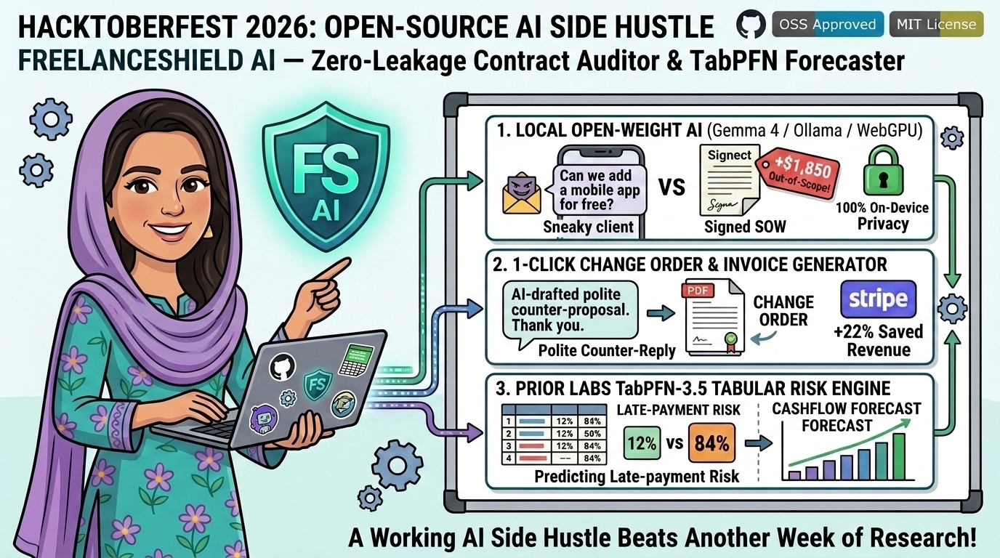
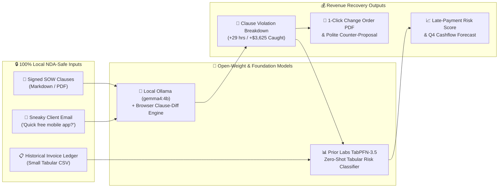

# 🛡️ FreelanceShield AI — Local Open-Weight Scope Creep Detector & TabPFN-3.5 Invoice Forecaster

> **Official Submission for the [DEV Hacktoberfest Open-Source AI Challenge Week 2: Side Hustle](https://dev.to/challenges/hacktoberfest-week2-2026-10-12)**  
> **Live Interactive Web App:** **[https://robinamirbahar.github.io/freelanceshield-open-ai-side-hustle/](https://robinamirbahar.github.io/freelanceshield-open-ai-side-hustle/)**



---

## 💡 What Problem Does It Solve? (Why Freelancers Pay $19/mo)

Independent developers, designers, and boutique agencies lose **22% of their annual income** to unbilled **"quick favors" (scope creep)** and **late-paying invoices**.

Yet freelancers **cannot paste confidential client Statements of Work (SOWs), NDAs, or private Slack threads into proprietary cloud LLMs** without violating strict client confidentiality clauses.

**FreelanceShield AI** is a local-first, open-source AI micro-SaaS side hustle that runs **100% on the freelancer's machine (or private self-hosted container)**:

1. **🦙 Local Open-Weight Scope Creep Radar (`Gemma 4 4B` / `Llama 3.2` via Ollama & In-Browser Clause Engine)**: Compares incoming client Slack/email requests against the signed SOW clause-by-clause—flagging out-of-scope deliverables with zero bytes of NDA leakage.
2. **📄 1-Click Polite Counter-Proposal & Change Order PDF Generator**: Automatically calculates billable hours at the freelancer's hourly rate and drafts a warm, high-converting Change Order (#CO-2026-089) with a printable PDF addendum.
3. **📊 Prior Labs `TabPFN-3.5` Zero-Shot Tabular Invoice Risk Forecaster**: Feeds the freelancer's small historical invoice table (5–50 rows—where traditional XGBoost overfits!) into **Prior Labs' `TabPFNClassifier`** to predict the exact probability of a `>14-day payment delay` and recommend whether to require a **50% or 100% upfront milestone deposit**.

---

## 🏗️ System Architecture



---

## 🚀 Quickstart (Run Locally in 60 Seconds)

### Option 1: Instant Browser UI (Zero Install)
Open **[https://robinamirbahar.github.io/freelanceshield-open-ai-side-hustle/](https://robinamirbahar.github.io/freelanceshield-open-ai-side-hustle/)** or open `index.html` directly in any modern browser. If you have **Ollama** running locally on `http://localhost:11434`, switch the top-bar dropdown to **🦙 Local Ollama API**!

### Option 2: Run the Python FastAPI + Ollama (`gemma4:4b`) + `TabPFN` Backend
```bash
git clone https://github.com/RobinaMirbahar/freelanceshield-open-ai-side-hustle.git
cd freelanceshield-open-ai-side-hustle

# 1. Pull open-weight Gemma 4 4B via Ollama
ollama pull gemma4:4b

# 2. Install FastAPI + Prior Labs TabPFN
pip install -r requirements.txt

# 3. Start the local API server
uvicorn agent_backend:app --reload --port 8000
```

---

## 📜 License
MIT License — Built with ❤️ by **Robina Mirbahar** for Hacktoberfest 2026 (`#hf26challenge`).


---

### 🚀 Featured Google Cloud & Agentic AI Portfolio by Robina Mirbahar

| Repository | Architecture & Focus | Live Status |
| :--- | :--- | :--- |
| **[gemma4-multilora-adk-eval](https://github.com/RobinaMirbahar/gemma4-multilora-adk-eval)** | Dynamic Multi-LoRA Hot-Swapping & CI/CD Agent Evaluation (`adk eval`) on Cloud Run GPUs with Gemma 4 & vLLM |   |
| **[slothsre-napops](https://github.com/RobinaMirbahar/slothsre-napops)** | SlothSRE ("NapOps") — Overnight Gemma 4 & Google ADK Incident Digest Agent with OpenTelemetry & Sentry AI Monitoring |   |
| **[streamforge-event-adk](https://github.com/RobinaMirbahar/streamforge-event-adk)** | Real-Time Event-Driven Multi-Agent Pipelines on Google Cloud with ADK (`ParallelAgent` & `LoopAgent`), Eventarc & Pub/Sub |   |
| **[a2a-mcp-mesh-cloudrun](https://github.com/RobinaMirbahar/a2a-mcp-mesh-cloudrun)** | Agent-to-Agent (A2A) & Multi-MCP Mesh on Cloud Run with Gemma 4, Google ADK, Spanner Graph & AlloyDB |   |
| **[cloudguard-gemma-agent](https://github.com/RobinaMirbahar/cloudguard-gemma-agent)** | 6-Part Production Gemma Enterprise Agent Series (ADK, Cloud Run L4 GPU, Firestore, Model Armor, Vertex AI QLoRA) |   |
| **[Comic-Studio-Ai](https://github.com/RobinaMirbahar/Comic-Studio-Ai)** | Multi-Agent Comic Generator powered by Google Gemini API & FastAPI deployed on Google Cloud Run |   |
| **[vertex-ai-imagen3](https://github.com/RobinaMirbahar/vertex-ai-imagen3)** | Generate AI-powered product & editorial images using Google Vertex AI Imagen 3 in Google Colab |   |
| **[Python-Learning-Assistant](https://github.com/RobinaMirbahar/Python-Learning-Assistant)** | AI-powered Python tutor covering 50+ interactive exercises with real-time feedback built with Streamlit + Gemini API |   |
| **[cozy-ai-agent-cafe-game](https://github.com/RobinaMirbahar/cozy-ai-agent-cafe-game)** | Prompt Paws: 60 FPS Cozy AI Agent Bakery Simulation Game teaching RAG, Guardrails, Context Caching & Multi-Agent Loops |   |

<div align="center">
  
</div>
