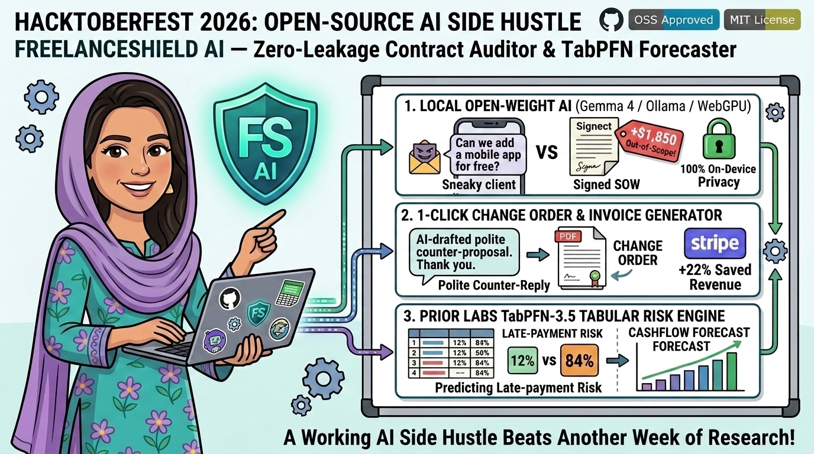
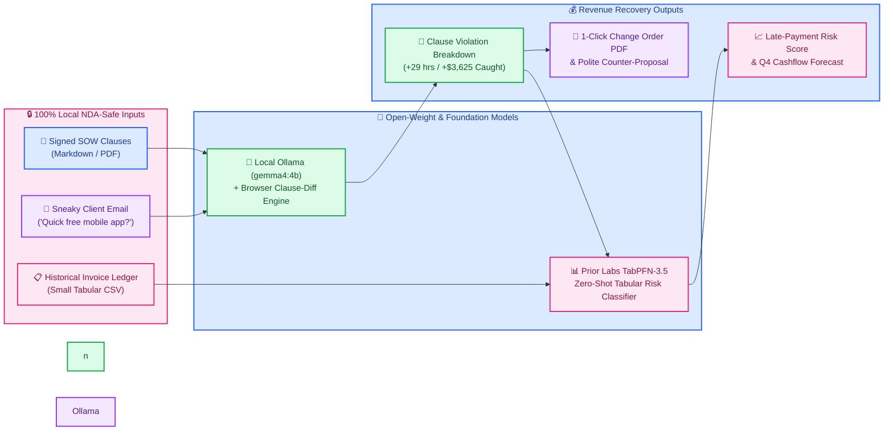

# 🛡️ FreelanceShield AI — Local Open-Weight Scope Creep Detector & TabPFN-3.5 Invoice Forecaster


> **Author & Architect:** [Robina Mirbahar](https://github.com/RobinaMirbahar) ([Google Developer Expert in Cloud & AI](https://developers.google.com/profile/u/106918534005910641104?utm_campaign=deveco_gdemembers&utm_source=deveco) · Google Cloud Champion Innovator · Co-Author of [*AI Engineering*](https://www.amazon.com/dp/B0GWCZWCF4))  
> 📚 **Companion Publications:** [DEV.to Featured Article](https://dev.to/robinamirbahar/freelanceshield-ai-local-open-weight-scope-creep-detector-tabpfn-invoice-risk-forecaster-83k) · [Live Web App](https://robinamirbahar.github.io/freelanceshield-open-ai-side-hustle/)  
> **Focus:** Local Open-Weight Scope Creep Detector, 1-Click Change Order Generator & TabPFN Invoice Risk Forecaster

---

## 🎯 Why I Built FreelanceShield AI (Engineering Purpose & Real-World Value)

### 1. 🛡️ Protecting Independent Engineers from Unpaid Scope Creep
Freelancers and boutique consultancies lose thousands of dollars when casual client messages quietly expand deliverables beyond the signed Statement of Work (SOW). I built FreelanceShield AI to compare incoming client requests against baseline SOW clauses automatically.

### 2. 📊 Hybrid AI: Open-Weights LLM + TabPFN Tabular Risk Forecasting
I combined local open-weights Gemma (for semantic contract diffing and 1-click Change Order drafting) with TabPFN foundation-model tabular inference to predict invoice late-payment probability.

### 3. 🔒 100% Local NDA-Safe Execution
Client contracts and pricing terms never leave your machine, ensuring strict NDA compliance.

---

> **Official Submission for the [DEV Hacktoberfest Open-Source AI Challenge Week 2: Side Hustle](https://dev.to/challenges/hacktoberfest-week2-2026-10-12)**  
> **Live Interactive Web App:** **[https://robinamirbahar.github.io/freelanceshield-open-ai-side-hustle/](https://robinamirbahar.github.io/freelanceshield-open-ai-side-hustle/)**



---

## 💡 What Problem Does It Solve? (Why Freelancers Pay $19/mo)

Independent developers, designers, and boutique agencies lose **22% of their annual income** to unbilled **"quick favors" (scope creep)** and **late-paying invoices**.

Yet freelancers **cannot paste confidential client Statements of Work (SOWs), NDAs, or private Slack threads into proprietary cloud LLMs** without violating strict client confidentiality clauses.

**FreelanceShield AI** is a local-first, open-source AI micro-SaaS side hustle that runs **100% on the freelancer's machine (or private self-hosted container)**:

1. **🦙 Local Open-Weight Scope Creep Radar (`Gemma 4 4B` / `Llama 3.2` via Ollama & In-Browser Clause Engine)**: Compares incoming client Slack/email requests against the signed SOW clause-by-clause—flagging out-of-scope deliverables with zero bytes of NDA leakage.
2. **📄 1-Click Polite Counter-Proposal & Change Order PDF Generator**: Automatically calculates billable hours at the freelancer's hourly rate and drafts a warm, high-converting Change Order (#CO-2026-089) with a printable PDF addendum.
3. **📊 Prior Labs `TabPFN-3.5` Zero-Shot Tabular Invoice Risk Forecaster**: Feeds the freelancer's small historical invoice table (5–50 rows—where traditional XGBoost overfits!) into **Prior Labs' `TabPFNClassifier`** to predict the exact probability of a `>14-day payment delay` and recommend whether to require a **50% or 100% upfront milestone deposit**.

---

## 🏗️ System Architecture



---

## 🚀 Quickstart (Run Locally in 60 Seconds)

### Option 1: Instant Browser UI (Zero Install)
Open **[https://robinamirbahar.github.io/freelanceshield-open-ai-side-hustle/](https://robinamirbahar.github.io/freelanceshield-open-ai-side-hustle/)** or open `index.html` directly in any modern browser. If you have **Ollama** running locally on `http://localhost:11434`, switch the top-bar dropdown to **🦙 Local Ollama API**!

### Option 2: Run the Python FastAPI + Ollama (`gemma4:4b`) + `TabPFN` Backend
```bash
git clone https://github.com/RobinaMirbahar/freelanceshield-open-ai-side-hustle.git
cd freelanceshield-open-ai-side-hustle

# 1. Pull open-weight Gemma 4 4B via Ollama
ollama pull gemma4:4b

# 2. Install FastAPI + Prior Labs TabPFN
pip install -r requirements.txt

# 3. Start the local API server
uvicorn agent_backend:app --reload --port 8000
```

---

## 📜 License
MIT License — Built with ❤️ by **Robina Mirbahar** for Hacktoberfest 2026 (`#hf26challenge`).
---

### Official Google Developer Resources
- [Google Gemma Open Models Documentation](https://ai.google.dev/gemma?utm_campaign=deveco_gdemembers&utm_source=deveco)
